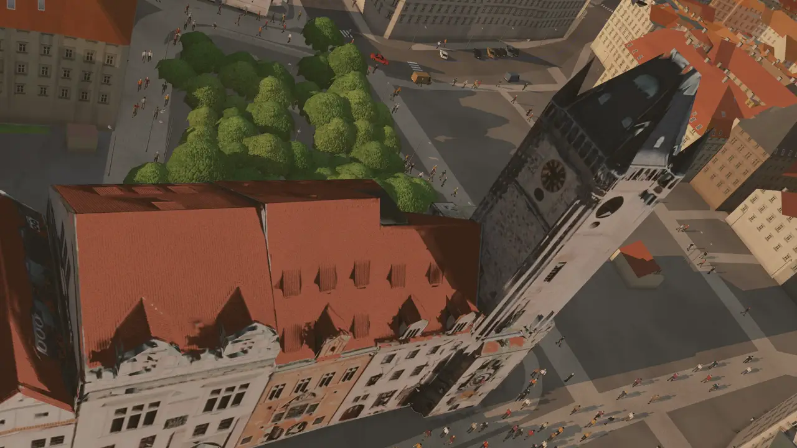

# Streets of Prague

A top-down driving sandbox set in today's Prague, in the spirit of the early GTA games.
Every street, building, tram line, parked car and hill comes from open data and is
drawn in the browser with three.js. Nothing is modelled by hand: the only pictures are
a small kit of windows, doors and shopfronts that every wall in the city is put
together from.

**Play it at [play.streetsofprague.com](https://play.streetsofprague.com)**, in a recent
browser on a computer, a tablet or a phone.



## What's in it

- The whole city of Prague as it is today, with IPR Praha's 3D buildings, bridges,
  terrain and photographed landmarks.
- Traffic and pedestrians, with trams, buses and the metro running to the real
  timetables. You can ride the trams, the metro and the Petřín funicular.
- Police who chase you when you misbehave, fire engines for burning cars, ambulances,
  taxis, dustcarts, and small jobs that pay.
- The sun follows Prague's real time of day. There are four seasons, changing weather
  (or the real weather in Prague, if you like), and lamp-lit nights.
- English and Czech, keyboard and mouse, touch controls and game controllers.

## Running it yourself

You need [Node.js](https://nodejs.org/) 20.19 or newer.

```bash
git clone https://github.com/jonasjancarik/streets-of-prague.git
cd streets-of-prague
npm install
VITE_DATA_URL=https://data.streetsofprague.com/$(cat deploy/data-version)/ npm run dev
```

Then open <http://localhost:5191>. The map isn't part of the repository: this command
borrows the one the public game uses. To build your own map from OpenStreetMap and
IPR Praha's data (needed to change how the map is made), install
[uv](https://docs.astral.sh/uv/) and [osmium](https://osmcode.org/osmium-tool/), then:

```bash
pipeline/build_map.sh ujezd --quick   # a few streets under Petřín
npm run dev                           # then http://localhost:5191/?area=ujezd
```

[Your first build](docs/handbook.md#your-first-build) in the handbook says what that
downloads, how long the bigger areas take and what `--quick` leaves out.

`npm run build` type-checks the code and makes a production build in `dist/`.

## How it works

The [handbook](docs/handbook.md) covers the rest: the controls and URL options, how
each part of the game works, the tests (`scenarios/`, run in headless Chrome), the
map pipeline (`pipeline/`, Python with [uv](https://docs.astral.sh/uv/)) and
deployment. Topics that need more room have their own pages in [`docs/`](docs/), and
larger changes were planned in [`plans/`](plans/).

A few links in `docs/` and `plans/` point into `docs/evidence/`: test captures and
logs that are kept locally and aren't published.

## Contributing and licence

[CONTRIBUTING.md](CONTRIBUTING.md) says how to get started, test a change and send it.
The code is free software under the [GNU Affero General Public License v3.0](LICENSE):
if you run a changed version for others to play online, offer them its source too.
The map data, sounds and other material from outside keep their own licences, listed
below.

## Credits

The game credits the map's sources in the corner of the screen (**Credits** opens the
list, with the licences), and the build writes the full licence texts of the bundled
libraries to `dist/licenses.txt`.

- Map data © [OpenStreetMap contributors](https://www.openstreetmap.org/copyright), ODbL.
- The countryside past the map's edge: OpenStreetMap data as vector tiles in
  [Protomaps](https://protomaps.com/)' basemap layout (ODbL), and ground heights from
  Mapzen's [terrain tiles](https://registry.opendata.aws/terrain-tiles/), kept as open
  data at AWS ([their sources](https://github.com/tilezen/joerd/blob/master/docs/attribution.md):
  SRTM, EU-DEM produced using Copernicus data and information funded by the European
  Union, and others).
- Tram and metro timetables: [PID / ROPID](https://pid.cz/o-systemu/opendata/), CC BY 4.0.
- 3D buildings, bridges and terrain: datový podklad ©
  [IPR Praha](https://geoportalpraha.cz/data-a-sluzby/clanky-a-projekty/3D-model), CC BY.
- Landmarks, and the roof and wall colours: photorealistic 3D model of Prague, datový
  podklad © [IPR Praha](https://geoportalpraha.cz/data-a-sluzby/clanky-a-projekty/3D-model/3D-mesh), CC BY.
- Carriageways and parking bays: Digitální technická mapa kraje, datový podklad ©
  [IPR Praha](https://geoportalpraha.cz/data-a-sluzby/28A24EB4-5EE8-436E-B0BB-357025258211), CC BY.
- Paid-parking sections and occupancy: [TSK Praha](https://zps.tsk-praha.cz/).
- Street lamps, manhole covers, storm drains and traffic-light poles: the surface marks
  of the archived utility map (DTMP_CUR_TMISZNAK_B), datový podklad ©
  [IPR Praha](https://geoportalpraha.cz/), CC BY.
- Lawns, meadows, flower beds, shrubs and hedges on city-managed land: vegetation
  elements (OPK_CUR_OPK_SMZ_VP_P and _B), datový podklad ©
  [IPR Praha](https://geoportalpraha.cz/), CC BY.
- Unmapped ground: orthophotos and the digital surface model ©
  [IPR Praha](https://geoportalpraha.cz/), CC BY 4.0; older surface model DMP 1G ©
  [ČÚZK](https://geoportal.cuzk.cz/), CC BY 4.0.
- Tram sounds: [Freesound](https://freesound.org), nearly all CC0; the motor's whine is
  [tramvaj nova prujezd nabrezi MS](https://freesound.org/s/621068/) by ozvuk,
  [CC BY 4.0](https://creativecommons.org/licenses/by/4.0/).
- City sounds: [Freesound](https://freesound.org); the Old Town crowds are
  [Prague, Staro Mesto, City Center](https://freesound.org/s/212034/) (parts 1 and 2)
  by vonfleisch, [CC BY 3.0](https://creativecommons.org/licenses/by/3.0/), the traffic
  [Prague Atmo Traffic from 5th floor](https://freesound.org/s/94309/) by aUREa,
  [CC BY 4.0](https://creativecommons.org/licenses/by/4.0/), the rest CC0.
- Recorded car engine (on the sound test page so far): three recordings of a
  [Hyundai Kona](https://freesound.org/s/845607/) by KVV_Audio,
  [CC BY 4.0](https://creativecommons.org/licenses/by/4.0/).
- Drawing: [three.js](https://threejs.org/) (MIT); map projections:
  [proj4js](https://proj4js.github.io/proj4js/) (MIT).
- Maps on the start screen and in the developer panel:
  [MapLibre GL JS](https://maplibre.org/) (BSD-3-Clause) with
  [OpenFreeMap](https://openfreemap.org/)'s vector tiles of OpenStreetMap
  ([OpenMapTiles](https://openmaptiles.org/) schema); address search by
  [Nominatim](https://nominatim.org/).

Every sound clip is listed with its recording, author and licence in
[`public/audio/SOURCES.md`](public/audio/SOURCES.md). The models, facade parts,
portraits and reflections, and how they were made, are in
[`assets/SOURCES.md`](assets/SOURCES.md).
