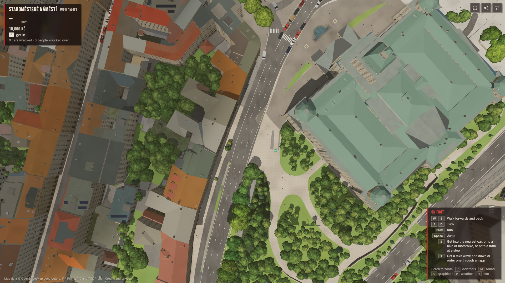

# Local work, 17-18 October 2026

<!-- read_when: reviewing the October 17 autonomous work; checking its evidence or preparing a release -->

This pass started at `63b8f82`. The local commits are listed in
[commits.txt](commits.txt). Nothing was pushed or deployed, and
the existing map was not regenerated. The pre-existing `screenshots/` directory
was left alone.

## Changes to review

| Area | Result |
| --- | --- |
| Map pipeline | Reject invalid partial builds and failed source pages; validate compressed downloads before caching; preserve good timetable files on failed refresh; key sampled imagery by source, grid and processing code. |
| Saves and controls | Validate nested saved state; keep the current game open when manual saving fails; release held input after focus/capture loss; keep dialogs paused and controller actions on the front dialog. |
| Rendering and streaming | Retire lamp indexes with distant graph tiles; fix loading/retry/disposal bookkeeping; finish failed renderer startup safely; stop sky and countryside-worker retry storms. |
| Transport | Repair metro ticket buttons and expiry, shared-bike accounting, reachable taxi selection, and two reproduced queue/merge collision mechanisms. |
| Forms and audio | Give stalled form requests a deadline while preserving typed text and uncertain-delivery wording; stop loading static after leaving a car and ignore events from replaced radio streams. |
| Visuals and parking | Keep road paint legible from above; reserve emergency centrelines and pickup clearance at sharp bends; add the IPR lamp attribution. |

## Verification

- [The consolidated offline run](offline-checks.json) passed 22 JavaScript checks
  at `f25eaed`; [63 Python tests](pipeline-tests.txt) also passed. Later form,
  countryside-worker, parking and traffic changes have their own focused checks.
- [The final production build](build.txt), including TypeScript, passed with the
  runtime now committed as `9732bbd`. This is a local build, not pushed CI or
  deployment verification.
- [The final default gameplay run](final-runtime/default/summary.json) passed
  **26 of 27 executed scenarios**, with four explicit countryside skips and no
  page errors. `pedestrians-escape` passed its escape and no-knockdown checks but
  ended at 9.8 km/h against a strict >10 km/h assertion. That failure is retained;
  the full suite was not repeated. An [earlier checkpoint](connector-merges/default-suite/summary.json)
  at `ece0889` passed all 27. Both used WebGPU, clear weather, summer, High graphics
  and 14:00. The final run recorded the exact pre-commit parking patch and runtime
  hashes now in `9732bbd`. After repairing demonstrated test setup gaps, the
  [single targeted pedestrian run](final-runtime/pedestrian-fixture/summary.json)
  passed at 35.1 km/h; its unchanged assertions and fixture correction are committed
  as `bef04e0`. This does not replace the original full-suite result.
- The final [four countryside scenarios](final-runtime/countryside/summary.json)
  and [three targeted WebGL checks](final-runtime/legacy/summary.json) all passed,
  with no page errors. A prior [native dialog/controller check](native-dialog.json)
  passed six assertions. [Material-sharing checks](material-sharing.txt) also
  passed after the harness was corrected to import the same Vite module instances
  as the running game; its incidental frame-rate sample is not performance evidence.
  [Tile-fetch validation](tile-fetch.txt) passed separately.
- [Two opposing boats at one mapped lock](two-boats.json) both cleared it in 474
  simulated seconds with no hull overlap. This was an isolated pair, with ordinary
  boat movement and surveyed water; it does not cover natural spawn queues.
- [The live WebGPU queue check](live-queue-check.json), at `478905e`, passed 2,401
  updates with natural jam-escape entry and no overlapping collision circles.
  The subsequent street-ID correction has offline reload-identity coverage.
- After the connector-merge fix at `ece0889`,
  [all four countryside scenarios](connector-merges/live-countryside.json) passed,
  followed by [three successful pickup trials](connector-merges/live-pickups.json).
  The original time limits were unchanged. Earlier [scenario failures](countryside-scenarios.json)
  and [a repeated pickup failure](countryside-repeat.json) are retained as before-fix evidence.
- The [initial centre-map parking correction](parking-after.txt) removed all
  [20 emergency-centreline findings](parking-before.txt), reducing parked cars
  from 21,731 to 21,689, with [no parked bodies touching](parked-body-overlap.txt).
  The final interior-bend correction then reduced parking by another 98 cars
  (0.45%) to 21,591. Its [approximate city sweep](parking-final.txt) reports no
  pickup or emergency-centreline findings and **222 remaining bus findings**.
  The removed pickup position was confirmed as a collision with actual vehicle
  bodies, and the [final focused regression](parking-regression.txt) passed.
  [Independent body checks](parking-bend-body-coverage.json) used the same source
  with temporary import paths; the [source mapping](parking-source-mapping.json)
  records that equivalence. The conservative reduction does not mean all 98 removed cars collided.
  Three tile halos added 0.12, 1.30 and 0.49 ms to median parking-index construction
  time; [raw samples](parking-bend-cpu-samples.json) retain the noisy tails.
  This is construction cost, not per-frame work or an FPS result.

## Road markings

These use the same frozen top-down camera above the National Museum at 260 m,
with the final materials'
minimum-width position graph disabled and enabled. They compare physical-width
paint with the held-width treatment; they are not separate deployed versions.
Nearby widths were also checked at 50 m on WebGPU and WebGL.
The HUD names the player's location, which is separate from this free camera.

| Physical width | Minimum pixel width |
| --- | --- |
|  |  |

The nine sampled tile builds gained 158,196 bytes of attributes in total and
0.05-0.28 ms at their build-time medians. Sharing the position graph prevented
extra shader compilation introduced by the first candidate; it is not a speedup
over the original physical-paint baseline. The busy machine's frame timings were
inconclusive. [Raw frame samples](road-paint-samples.json) and the
[performance note](../../performance-log.md#road-markings) record the limits.

## Still open

The earlier taxi [blocker chain](taxi-residual-blockers.json),
[world snapshot](taxi-residual-world.json) and [capture](taxi-residual.png) preserve
the failure that led to the connector-merge fix. The
[frozen reproduction and validation](connector-merges/README.md) show what changed
and correct an intermediate test error involving a removed car. Two short-road
bus-turn overlaps remain in the heavy-vehicle matrix; the live successes do not
establish that every taxi trip or intersection is free of jams.

The street-chunk endpoint correction needs a map rebuild before it changes the
game's existing map. Regenerate street-ID dependent outputs, including signals,
in the documented sequence. Bus clearance on bends, phone testing, quiet-machine
frame benchmarks, and earlier intermittent fire scenarios remain separate work.
The original pedestrian speed failure remains unattributed: its run did not
capture the post identity or collision history. A separate [controlled fixture](pedestrian-coast-fixtures.json)
([replay script](pedestrian-coast.mjs)) proved two test setup gaps: only 32 m of road was checked for a coast that travels
about 39 m, and normal frames could advance the world between manual steps. The
scenario now checks 48 m, holds automatic simulation paused during its three
simulated seconds, restores prior state and records the final probe. The speed
threshold and pedestrian assertions are unchanged. This repairs those demonstrated
fixture gaps; it does not establish what caused the original 9.8 km/h result.

Claude Sonnet 5.5 completed editorial reviews of the save/attribution copy,
road-marking note and parking note. The form-copy, connector-evidence and final
review-pack editorial attempts were unavailable because the CLI rejected that
model. The completed reviews were editorial, not fact verification.
