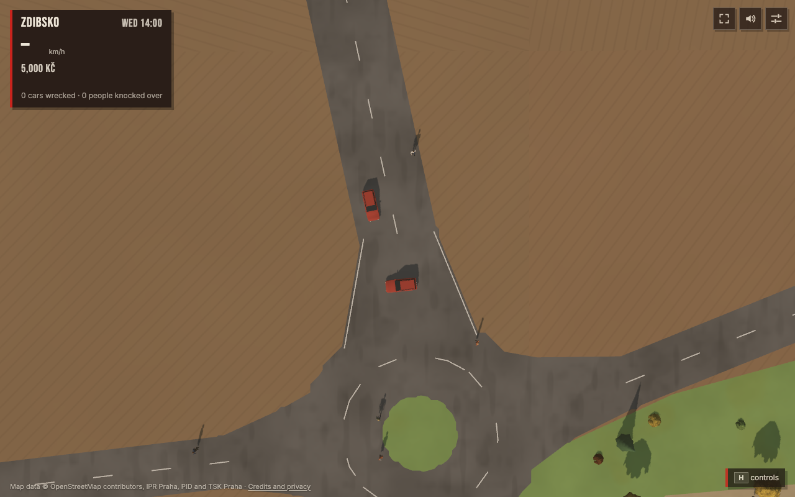

# Connector merge investigation

<!-- read_when: investigating countryside taxi pickup jams or changing traffic merge precedence -->

These CPU-only fixtures use the shipped SUV bodies and route code, with 1/60 s
steps for 60 s. They isolate two mechanisms rather than replaying the original
random traffic population. Source snapshots are inert `.txt` evidence; the runner
loads them without changing production files or starting a renderer.

| Traffic source | SHA-256 |
| --- | --- |
| Baseline, commit `22deab55a10fb8019c5a42b98e95399af921ee79` | `f3843d7d1d66dc23541db590d534ff6f02bae076bbbceefc1e8a6f1bd6299510` |
| Experimental v5, `candidate-v5.ts.txt` | `31fe647ba28b3cbc06b506b076c2fc277aa1a37c58fc95def7a73d9bc345f8b7` |

The first fixture uses the three captured Zdibsko roads. The northern approach
starts at route distance 61 m and 3 m/s; the other starts at 0 m and 7.8 m/s.
Both begin with jam escape inactive. Baseline collision circles first overlap at
3.4 s, before jam escape starts at 6.75 s; both cars remain jammed after 60 s.
The ordinary crossing rule delays braking while both enter from connector legs.
V5 keeps these two cars separated and both finish.

The second fixture holds a branch car on a T-junction connector with a person,
clear of straight traffic. The straight car starts at route distance 10 m and
8 m/s. Remove the person at 3.5 s. Both variants finish without overlapping.

| Fixture | Baseline minimum clearance | V5 minimum clearance |
| --- | ---: | ---: |
| Captured connector merge | -1.919720 m | +6.644931 m |
| Held connector, release at 3.5 s | +1.248735 m | +1.757447 m |

**Measurement correction:** the earlier release test reported -1.854233 m for
v5 because it compared the follower with the branch car's stale body after that
car had left the simulation. That was a test error, not a collision. Requiring
both cars to be active corrects the [101-phase release sweep](release-phases.json) to 13 baseline overlap
cases and zero v5 overlaps. The earlier claim of ten new collisions is withdrawn.
Completion alone does not prove separation; clearance must also exclude removed
actors. The runner applies that rule on every frame.

Earlier prototype versions did produce valid false queues on distant parallel
approaches, beside a yielded/adopted car on the same road, and behind a clear
stationary connector car. Those findings must not be confused with the withdrawn
v5 release claim. V5 includes restrictions for those cases; this two-case replay
alone does not establish citywide safety or live gameplay behavior. The separate
[360-case actual-car matrix](matrix-summary.json) has 358 collision-free v5 cases
and two remaining baseline bus-turn overlaps: a 2 m outgoing road followed by a
90-degree exit, in both update orders. Their penetration decreases from about
1.98 m to 0.139 m; all cars finish. These remain unresolved collision cases.

```sh
node docs/evidence/local-pass-2026-10-17/connector-merges/reproduce.mjs
```

[Source and dependency hashes](sources.json) and [recorded results](results.json)
make the replay inspectable. Future changes must retain full collision-circle
checks throughout movement, stopping and release; verify connector-to-road
handoff, both update orders, heavy vehicles and short outgoing roads; and preserve
clear through traffic, roadside yielding, pavement adoption, distant-parallel and
winding-approach controls. Measure CPU cost separately. Do not extend the taxi
scenario timeout or relax collision checks to make it pass.


## Live check at ece0889

The [WebGPU session](live-backend.json) used commit
`ece08897ab305fc1f592d80fea93bd489accccc7` and the same traffic-source hash as v5.
The [captured connector replay](live-captured-connector.json) observed 3,612
updates, no overlap, minimum clearance +6.644931 m and both cars finishing.
The isolated cars used ordinary routes and movement, with lifetime retention
while background traffic spawning was quiet; route completion required `gone`,
so background recycling could not count as success.

[All four countryside scenarios](live-countryside.json) passed. Taxi pickup took
146 simulated seconds with two bookings, within the unchanged 240-second limit;
the ride returned to the built map after 80 seconds. [Three planned pickup
trials](live-pickups.json) then passed in 56, 12 and 12 seconds, one booking each.
All recorded page-error arrays were empty. These are one live session and three
pickup samples, not a claim that every pickup or traffic jam is resolved. Earlier
failed runs remain failures in the parent evidence folder.




## Full default suite at ece0889

The [complete default run](default-suite/scenarios.json) at the same commit
passed all 27 executed scenarios, with four explicit countryside skips and zero
page errors. It ran once, without repeats. The [verified backend and initial
settings](default-suite/backend.json) match the earlier `22deab5` checkpoint:
WebGPU, clear weather, summer (`07-15`), High graphics/tier, 14:00 and `&dev`.
[Source metadata](default-suite/source.json), [the complete log](default-suite/scenarios.log)
and [the summary](default-suite/summary.json) record the unchanged final HEAD.
The owned browser was stopped afterward. This is a local integration check,
not pushed CI or deployment verification.
