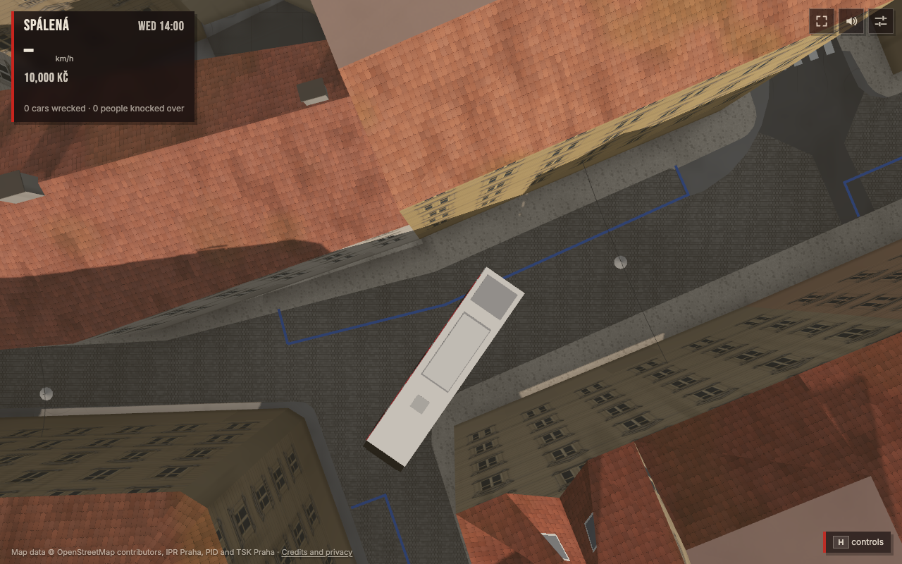

# Parking clearance evidence

read_when: reviewing commit 376a71d or replaying the parked-car corner regression.

The controlled replay reproduced a **0.377 m collision-circle overlap** between a
12 m bus and an old accepted hatchback at Ostrovní → Opatovická. Candidate parking
rejected that position; the same actor completed the turn without touching parked
cars. Both images show the same simulation time, 2.5 seconds into the drive.

| Baseline placement | Candidate parking |
| --- | --- |
|  |  |

[Replay measurements and image SHA-256 hashes](replay.json) ·
[Opposite tile reload orders](reload-order.json) ·
[Loaded-scene counts and ordinary-car search](scene-summary.json)

## Provenance and limits

- Candidate source: `376a71de027b0f9da3672d7b3dec642595e45933`.
- Baseline parking generator: `b3c22d5:src/parking.ts`, called against the real
  collision grid and posts. One accepted old car was reinserted into the candidate
  runtime for the baseline phase. This was not a second complete baseline world.
- Private `centrum` map built `2026-10-02T20:16:12Z`, served from worktree `d122`
  on port 5206; WebGPU, Wednesday 14:00, clear weather.
- Parked hatchback: latitude `50.08075394817763`, longitude `14.418088551117165`;
  local position `(-136.81308152859725, -82.9820618619707)`, heading
  `3.553146452691224` radians, tile `8_5`.
- Incoming edge `25656653>25656648>0`, outgoing edge `25656648>25656646>0`.
  The actor followed that graph turn; this does not establish a scheduled PID line.
- Camera: that latitude/longitude, height 48 m, tilt 0°, heading 0°. Captured on
  3 October 2026 at approximately 04:16 Europe/Prague.
- Other traffic spawning, people and signals were temporarily suspended in this
  private scene and restored after the pair. The full game simulation drove the
  actor and supplied the parked cars; overlap was measured with its collision circles.
- Both phases completed in 6.9 simulation seconds. Baseline minimum separation was
  `-0.37652127399309454` m; candidate minimum separation was
  `22.756342485765842` m. Neither actor was damaged or entered its ignore timer.
- Tiles `8_5` and `7_5` regenerated in opposite orders with identical 103/78-car
  layouts and zero duplicate centres. An ordinary-car overlap was not reproduced
  among these nearby candidates; ordinary/curved/narrow turns have CPU regressions.
- No citywide drive, emergency-route test or performance comparison was run.
  The scene browser closed and its GPU lock was released after capture.

## Replay

The archived scene snippets are [scan.js](scan.js), [find-turn.js](find-turn.js),
[replay.js](replay.js) and [reload-order.js](reload-order.js). They use the repository's
scene runner, not a separate browser script. The map data and dependencies must be
private copies. Verify the map build marker above and acquire the shared GPU lock
before starting a browser.

For the temporary baseline module, stage `git show b3c22d5:src/parking.ts` in `/tmp`,
then copy it to a **new, absent** `src/parkingBaseline.ts`; never overwrite a tracked
file. Start the scene server against the candidate on ports 5206/5306, then execute
each snippet with `node scripts/scene.mjs eval "$(cat <snippet>)" --port 5306` in the
listed order. Stop the scene browser, trash the temporary module and release only
your own lock. The source-controlled CPU regression also retains a small snapshot
of the two real road edges, so its geometric check needs no map download.
