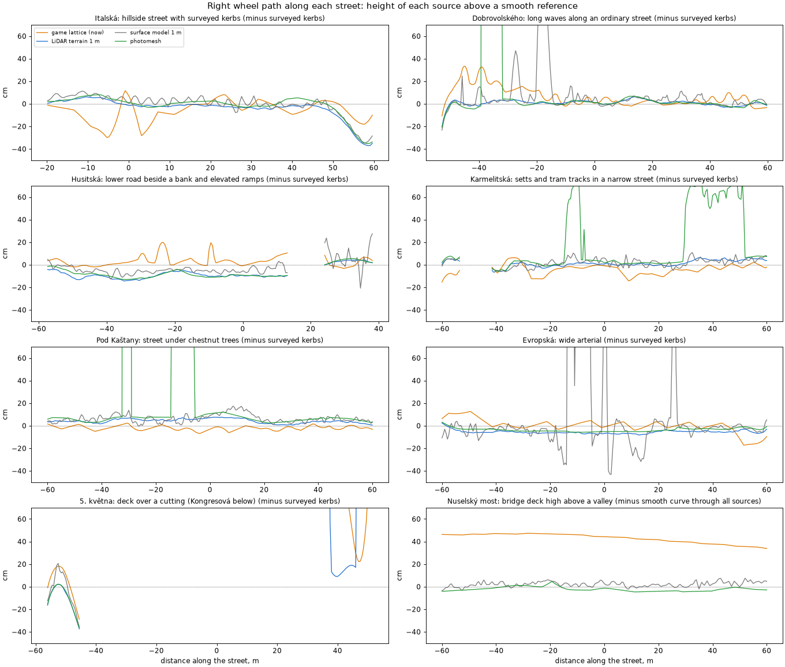
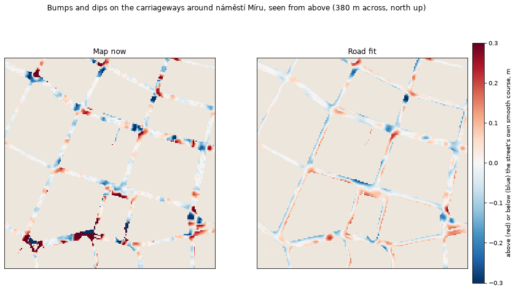
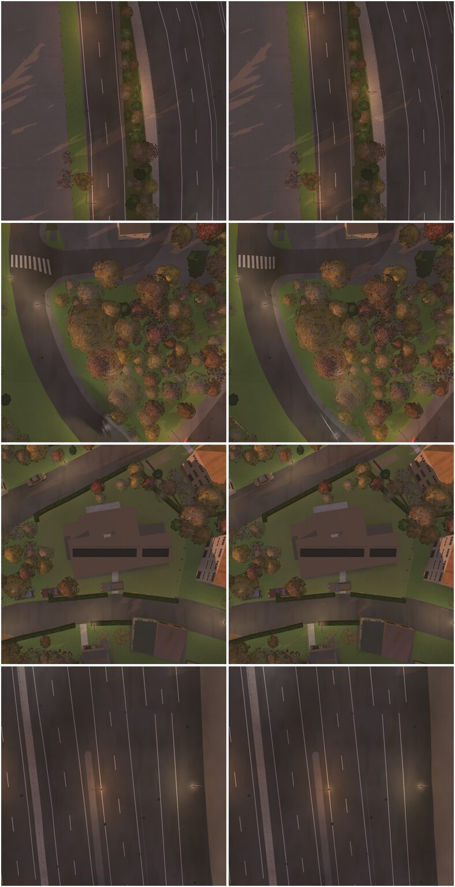

---
read_when:
  - A street looks broken, tilted, bumpy or sunk in the game
  - Changing pipeline/dtm_heights.py's street heights, structures.py's bridges and tunnels, or src/stepEdges.ts
  - Thinking of another source for street or ground heights
  - Choosing which measurements to fit a road surface to
  - Working on pipeline/road_fit.py or the ?roadfit preview
---

# Road surfaces: findings, fixes and further research

Work of 5 November 2026 on branch `flat-roads` (worktree with cloned data). The
user's complaint: street surfaces "not flat, broken up a lot", then a wall across
5. května and a dip at náměstí Hrdinů, then a broken patch on 5. května by
Kongresové centrum (50.06130, 14.43124).

Consolidated on 6 November 2026 with additional research into data sources and road
reconstruction. The fixes, visual observations and before-and-after counts below
come from Claude's implementation investigation. The additional research inspected
the pipeline and cached survey records and checked public data catalogs on 5 November;
it did not rebuild the map or validate the proposed approaches in the game. Source
availability and licensing below describe that research snapshot. Subsequent
[implementation trials](#implementation-trials-6-november-2026) record the work
and measurements from later on 6 November.

## Where a street's shape comes from

- **Outline:** the technical map's (DTM ZPS) street polygons, cut per tile in
  `osm_area.py`. OSM only says which street it is and whether it's a bridge or a tunnel.
- **Height:** the shared lattice, a point every ~4 m, from IPR's terrain model
  (a TIN with points ~10 m apart), corrected by `dtm_heights.apply` with the survey's
  kerb lines. The game drapes the ground over the lattice (`src/ground.ts`, triangles
  of 8 m, normals straight up).
- **Bridges and tunnels:** levels of their own with their own heights
  (`structures.py`), drawn over or under the ground.

A street 15 m wide is only three or four lattice points across, so whatever the
lattice gets wrong shows on the street.

## Findings

1. **Streets leaned and twisted across.** Each point on a street took its height
   from the 6 nearest kerb points. On a hillside the uphill and downhill kerbs differ
   by up to a metre, so the street tilted towards whichever kerb was nearer, and
   the tilt changed from cell to cell. Fix: `_level_across` makes a car street level
   from kerb to kerb (the mean of both kerbs across from each point). It skips kerbs of
   streets passing under or over it, and blends where streets meet.
   `ipr_terrain.py --no-level` builds without it.
2. **The parapet across 5. května at náměstí Hrdinů** was a step-edge parapet
   (`src/stepEdges.ts`), not a bridge's. A bridge's street gets a flat terrace before the
   bridge (`structures.pads`), a step over the ground under the deck, and bridge ways
   never counted as streets crossing that step. Fix: each end of a bridge's raised
   stretch now counts (`bridgeEnds` in `src/tiles.ts`).
3. **The dip before the bridge there** came from fix 1: the levelling skipped
   everything within 6 m of a bridge, so the street's last metres kept heights smeared
   down from the cutting. Fix: skip only points under the bridge's outline.
4. **Tried and dropped:** extra flat terraces for the low ground under bridges. They
   made steps over 1 m rise from 36 to 48 (Pražský okruh under overpasses, Štefánikův
   most's join) with no visible gain.
5. **5. května by Kongresové centrum:** Kongresová passes under it. OSM maps a tunnel
   45 m long; IPR's terrain model has an open cutting 20 m wide and 6 m deep there,
   because the model leaves the deck over it out, as it does every bridge's. So the game
   stood the tunnel's 5.5 m walls up out of the cutting and laid 5. května down in it.
   The surface used by the existing survey-height path merges the street on top and
   the one below, so those kerbs did not resolve the crossing. The later inspection
   found additional elevated survey objects nearby; their relevance to the full
   crossing still needs checking (see "More of the existing technical map").
   - Tried: raising the ground over a tunnel from the ground beside it. Nothing
     changed: the ground beside the tunnel is in the cutting too.
   - Tried: bridging each street that crosses a tunnel straight from its heights on
     either side. It filled the dip but left the road patchy and the walls in pieces,
     and it hit streets going down past real portals (Radlická at the Strahov tunnel,
     Za Elektrárnou, Blanka).
   - Done: `structures.cuttings`. A tunnel under 80 m long, crossed by a car street
     whose terrain dips more than 2 m under it, with the street about level from side
     to side, is turned round as the terrain model has it. The underpass is on the
     ground in its cutting, and the street over it is on a short bridge (a way marked
     `cut`, without pads). The street on the ground gets that stretch as a level
     (`OnLevels.over_cutting`), and the game paints it on the deck (`onDeck` in
     `src/ground.ts`). Under such a bridge the ground is the cutting's, whatever kerbs
     are nearest. Two traps on the way: the underpass's own street crosses the new
     bridge's line, so only stretches running along it count as on the deck; and a
     two-way street is two edges along one line, which gave two decks until one was
     dropped. Footway and cycleway subways are left alone: Povltavská's became a deck
     standing across the street, and a subway really is covered.

     The praha build turns 6 underpasses round: Kongresová under 5. května, under
     Barrandovský most's approach, under Wilsonova, under Pražská, under a motorway
     link at 49.98, 14.48, and Hartenberská under Pražský okruh. In Claude's visual
     inspection, all but Wilsonova (no change) looked better than before.
     Pražský okruh keeps one step
     where its deck ends (4.7 m, flagged `deck` by the flatness check), still less
     broken than before.

## Numbers

`node scripts/check-road-flatness.mjs praha` (car streets with a finding):

| Problem | Before | After fixes 1–3 |
|---|---|---|
| Steps over 1 m | 40 | 35 |
| Bumps over 0.5 m | 683 | 563 |
| Leaning over 15 % | 4039 | 3026 |
| Ridges or troughs over 1 m | 216 | 151 |
| Twisting over 12 % | 2912 | 2479 |

Fixes 1–3 are in main since 34c361d, with the map rebuilt. Fix 5 is committed on
`flat-roads` as `ccd182f3`; its results are not included in the table. It changes
these counts by a street or two either way (steps over 1 m 35 → 36: the Pražský
okruh deck end).

## Checking a place

- `node scripts/check-road-flatness.mjs praha --near lat,lon,120` lists what's
  wrong with the streets round a place; `--save`/`--against` compare two builds.
- `uv run --project pipeline python .agents/skills/terrain-steps/terrain_at.py praha lat lon`
  prints the lattice there, with labels and level heights.
- `node scripts/check-step-edges.mjs praha` checks solid edges and parapets. It now
  uses the same raised bridge-approach segments as the game (`src/roadLevels.ts`),
  so bridge entrances are open in the offline check as well as at runtime.
- A height map with the tunnels, bridges and streets drawn over it shows a trench
  or a hump at a glance. That's how the cutting at Kongresová showed up.
- From above and from a low oblique angle, before and after:
  `node scripts/scene.mjs eval --url … "await t.camera({at:[lat,lon], height:25, tilt:55, heading:330, level:true}); await t.shot('x')"`.
  A first-person view shows the same breaks much more harshly.

The normal top-down camera is the acceptance view for the game. Oblique and
first-person views are diagnostic aids. Keep the actual camera pose fixed when
comparing builds: a camera height relative to changed terrain can move the viewpoint.
See [the terrain investigation](river-terrain-findings.md) and the
[terrain skill](../.agents/skills/terrain-steps/SKILL.md) for the comparison workflow.

## Data sources to investigate

### More of the existing technical map

There is useful information in the cached DTM ZPS packages that the road-height
reader does not retain. The packages inspected contain bridge footprints
(`Plocha mostní konstrukce`), tunnel surface polygons, terrain breaklines, object
identifiers, placement levels, height-accuracy classes and acquisition methods.

In [dtm_heights.py](../pipeline/dtm_heights.py), `_tables` returns object type,
placement level and geometry. `survey` retains selected objects at level zero;
surface polygons become two-dimensional, and wall lines lose their heights.
Most source attributes are not carried forward. This is specifically the
survey-height path: [dtm.py](../pipeline/dtm.py) already retains placement levels
for its selected surface types and exposes raised carriageways.

Within 35 m of the reported Kongresová coordinate, the cached packages contained
a bridge footprint, level-1 road polygons and level-1 survey lines. For example,
bridge footprint `1000338903053` and road polygons `1000338903031` and
`1000338903032` have placement level 1. Their polygon geometries have no Z values,
so they can inform the extent and identity of a deck, not directly its height.
Elevated line records nearby do carry measured heights.

Matching the survey polygons to the actual crossing, near 50.06160, 14.43082,
showed why the original cutting rule missed part of 5. května. Its 38.0 m deck
follows one carriageway (DTM `1000338903031`). The other carriageway and its slip
road run through DTM `1000338903032` on the same footprint. The nearby level −2
tunnel `1000414175124` belongs to a different crossing. Its closest point is
14.6 m from the original deck centreline. The carriageway and footprint exports
are from 31 October 2026. The construction-line export is from 31 August 2026.
The bridge perimeter has uncertain height accuracy (class 9). Class 3 and 5
measurements along the second carriageway's kerbs and median support a surface
around 241 m. [ČÚZK rules for structure footprints](https://dtmwiki.cuzk.gov.cz/01_pravidla/01_zaklad/04_plosne_objekty_zps),
[survey accuracy classes](https://dtmwiki.cuzk.gov.cz/01_pravidla/01_zaklad/02_presnost).

The optional `--survey-companion-decks` uses that relationship to add 39.2 m of
5. května and 43.7 m of its slip road. The source observations verify the deck
level against both approaches, and the profiles join the terrain heights at
their ends. In a six-tile comparison, the largest bump on the added 5. května
stretch fell from 1.05 m to 0.01 m, and its cross-slope from 31.7% to 3.9%.
The slip road went from a 1.01 m bump and 41.6% cross-slope to 0.06 m and 4.7%.
Kongresová stays on the lower ground, where it still has a 0.71 m bump and
29.5% cross-slope. The change relies on an existing cutting deck and leaves the
original rule in place for crossings without a match.

The separate DTM transport-infrastructure model also defines road axes, network
nodes and bridge extents. Its populated coverage and usefulness here remain to be
checked; the existence of a schema does not prove local completeness.
[Official DTM transport-infrastructure attributes](https://dtmwiki.cuzk.gov.cz/03_di_metodika/07_prilohy/03_atributy_di).

### IPR's LiDAR-derived terrain raster

IPR describes a new terrain survey acquired in 2023 using LiDAR, with at least
20 input points/m², and an open terrain raster at 1 m resolution. The raster's
metadata describes approximately 40 input points/m², a 2023 revision and CC BY
licensing. These densities concern the source survey, not the output grid.
[IPR terrain description](https://geoportalpraha.cz/data-a-sluzby/clanky-a-projekty/3D-model/3D-model-dtm),
[raster metadata](https://www.arcgis.com/sharing/rest/content/items/97d2c9c11aa9478cb21b469b8a4f820e/info/metadata/metadata.xml?format=default&output=html).

The current importer reads `TER_*` CityGML TIN sheets, documented as having points
approximately 10 m apart. Compare the two products at difficult places before
assuming the 1 m raster is an improvement: the research verified its publication
and provenance, not its accuracy relative to the imported TIN. It remains bare
terrain and omits bridges.

The ArcGIS catalog item is `97d2c9c11aa9478cb21b469b8a4f820e`. Use the numeric
terrain download for such a comparison. The inspected `d3m/stinovany_relief`
ImageServer returns an unsigned-byte shaded image, not elevations; even its
`None` rendering function does not turn those pixels into heights.

### IPR's surface model and photorealistic mesh

The project already has a local 1 m digital surface model (DSM), used by
[ground_cover.py](../pipeline/ground_cover.py) for ground cover and vegetation.
Its catalog item is `a6120ef1652e4df2b1202c1a8ad4e0c7`. IPR also describes a
25 cm DSM, generated from aerial images and updated annually. Unlike bare
terrain, it includes visible structures, but also vehicles and vegetation.
[IPR surface model](https://geoportalpraha.cz/data-a-sluzby/clanky-a-projekty/3D-model/3D-model-dsm).

Use it as evidence for road patches that join smoothly to their approaches.
Directly copying its heights, or taking the maximum of terrain and DSM, would
turn cars and trees into road humps. A promising combination is surveyed polygons
for road extent, bare terrain for surrounding land, and selected DSM observations
for a deck above a cutting. Aerial data cannot measure a lower road hidden by a deck.

IPR's photorealistic mesh can provide visible deck geometry and structural edges
missing from the terrain model. It is an open dataset based on summer 2023 imagery
and contains vegetation, vehicles and other objects. Its approximately 5 cm texture
resolution is not a claim of equivalent geometric accuracy. The project already
reads the mesh through [photomesh.py](../pipeline/photomesh.py).
[IPR photomesh description and downloads](https://geoportalpraha.cz/data-a-sluzby/clanky-a-projekty/3D-model/3D-mesh).

One experiment would fit simple road surfaces to selected mesh observations,
rejecting vehicles and vegetation, rather than importing the mesh triangles.
Coverage of lower roads remains limited by what the aerial acquisition could see.

### Street LiDAR

IPR's search-indexed mobile-mapping article describes laser scanning in 2020–2021
across publicly accessible paved streets. The article failed to load directly
during research, so citywide access remains an unconfirmed lead.
[Indexed mobile-mapping article](https://test.geoportalpraha.cz/data-a-sluzby/clanky-a-projekty/3D-model/3d-model-lidar).

Public IPR point-cloud catalog entries were independently verified, including
`Lidar_Col_10_Magistrala`, item `21e084b84af14421abb0cb09765cd888`. That sample
covers part of the central Magistrála, not Kongresová. Its license field was empty;
public visibility alone does not establish permission to redistribute derived
geometry. [Magistrála sample](https://www.arcgis.com/home/item.html?id=21e084b84af14421abb0cb09765cd888).

Road-only extracts or cross-sections could be especially useful for kerbs and
road floors under overhead structures, where aerial products cannot see. Before
depending on this source, establish actual coverage, downloadable formats and
terms for distributing derived game geometry. No request for data was sent.

### ČÚZK terrain and surface products

The existing [dmr5g.py](../pipeline/dmr5g.py) prototype uses DMR 5G for bare-earth
heights. It is a candidate for terrain comparisons and areas outside IPR's coverage.

The newer DMP OK is a different product: a surface model from image correlation.
Its metadata lists point data at 0.2 m spacing and a 0.5 m raster, with acquisition
in 2024–2025 and CC BY 4.0 licensing. It offers another source for comparison and
coverage beyond Prague. Fine spacing does not imply equivalent vertical accuracy,
and aerial measurements cannot recover hidden road surfaces.
[DMP OK metadata and downloads](https://geoportal.gov.cz/php/micka/record/basic/CZ-CUZK-DMPOK?dlang=cze).

### Mosaic REALMAP

Claude's original investigation records [Mosaic REALMAP](https://realmap.mosaic51.com)
as street-level photography, not a ready-made 3D model: approximately 1.2 million
georeferenced images, one every metre, totaling 4.6 TB, with access through a form
and a CC BY-NC-SA license. Those acquisition details and terms were not independently
rechecked during the additional research.

The original decision was to exclude it as a source for the game's distributed
data because of the non-commercial and share-alike terms. A few image sequences
could still help investigate what exists at a broken location, subject to their
access terms. Street photography is also less directly useful for the game's
top-down presentation. This dataset is separate from the street LiDAR lead above.

## Proposed road model

The main architectural experiment is to reconstruct connected road surfaces from
measurements. The coarse terrain would continue to describe the surrounding land.
This is a proposal, not an implemented or validated replacement for the fixes above.

### Profiles and junctions

Give each street a smooth height profile along its length and a controlled
cross-section across its width. Fit measurements robustly, weighting their quality
and rejecting outliers so one bad survey vertex or parked vehicle cannot bend the
road. Retain real longitudinal slopes, banking and road crown; zero cross-slope
should be a fallback when evidence is weak, not the universal definition of a
correct road.

Junctions need shared patches joining their approaches. Independently smoothed
streets can still arrive at different heights or slopes. ASAM OpenDRIVE's separation
of longitudinal elevation and lateral shape is a useful precedent; adopting the
format itself is not required.
[ASAM road geometry](https://www.asam.net/fileadmin/Standards/OpenDRIVE/ASAM_OpenDRIVE_BS_V1-7-0.html).

### Connections and crossings

Resolve which surfaces physically connect before fitting their heights. Use road
continuity, survey placement levels, bridge outlines, OSM connectivity and observed
heights to associate measurements with the upper or lower carriageway. Only surfaces
that actually join should share continuity constraints. Keep conflicting evidence
visible instead of silently averaging it.

The short-underpass rule can remain a fallback where structural information is
missing. Where explicit evidence exists, use it to establish the deck's extent and
connections rather than making tunnel length and a terrain depression the main test.

### Geometry and vehicle sampling

Keep fitted road surfaces out of the coarse terrain lattice. Triangulate them with
vertices along kerbs, junction joins, portals and deck ends; retain walls as explicit
edges that triangles cannot cross. Flat stretches need few triangles, while changing
profiles need more. Join surrounding terrain, pavements and walls to the road at
explicit edges, retaining genuine steps where appropriate.

Rendering and vehicle-height queries must use the same reconstructed surface.
A visual overlay alone would leave vehicles following the old bumps. A pilot can
replace one connected area while leaving the rest of the map on its existing model.
The runtime and memory cost of this representation has not been measured.

## Further experiments

These are untested extensions of the proposed reconstruction approach.

- **Find structures through source disagreement.** A continuous road-shaped surface
  above a depression in bare terrain is a candidate deck. Require connectivity and
  supporting mapped objects: buildings, trees, vehicles and different survey dates
  can also produce height gaps.
- **Use acquisition dates to reject temporary objects.** A protrusion that moves or
  disappears is weak evidence for permanent geometry. Compare dated observations;
  blindly taking the minimum across years could erase a rebuilt road or select the
  lower road at a crossing. Availability and alignment of suitable repeated coverage
  still need checking.
- **Record manual corrections as relationships.** A reviewed instruction such as
  "this carriageway joins this deck" or "this wall ends here," with its source, date
  and reason, could survive updates better than a location-specific smoothing rule.
  Let the same reconstruction process derive the geometry from those constraints.

## Suggested comparison

Start with four small areas rather than a citywide rebuild:

| Area | What it tests |
|---|---|
| Kongresová / 5. května | Assigning the crossing roads to the correct surfaces |
| Italská | Preserving a hillside street's profile without artificial cross-slope |
| Hořejší nábřeží | Separating a road from the retaining wall beside it |
| An ordinary junction, chosen before testing | Preserving a place that already works |

First match the unused technical-map objects to the roads and compare the terrain
products. Then fit independent road patches using the most reliable observations.
Keep input versions and a baseline so changes in data and reconstruction can be
distinguished.

Compare fixed top-down views, joins, slope continuity, separation between crossing
roads and agreement between rendered geometry and vehicle samples. Reuse
`scripts/check-road-flatness.mjs`, `scripts/check-bridge-decks.mjs` and
`scripts/check-step-edges.mjs` on baseline and candidate data; inspect the chosen
locations as well. Better flatness counts must not come from deleting genuine slopes
or hiding one road beneath another. Check seams where the pilot meets unchanged tiles.

Priority: use more of the existing survey, compare the LiDAR terrain raster, then
pilot explicit road surfaces. Investigate street LiDAR access for cases the existing
sources cannot resolve. The trials below test several of these directions.

For a comparison with a simpler renderer, see
[how Tiny Prague renders roads](tiny-prague-road-rendering.md).

## Implementation trials, 6 November 2026

The overnight work used isolated checkouts based on `flat-roads` at `3dfafe52`.
The integrated code is on `codex/road-reconstruction`. The baseline Prague map
was built at `2026-11-05T22:58:30Z`; its producer identifies itself as
`34c361d375-dirty` (a dirty working tree), distinct from the `3dfafe52` checkout
base used for these experiments. The final survey candidate was built at
`2026-11-06T00:13:10Z` from `d5e2afebc7` and copied into the integration preview.
No production deployment or push was performed.

### Survey-supported decks at Kongresová

The additional survey records address a specific omission. The existing inferred
bridge carried one 5. května carriageway. A second carriageway and its connected
slip road belonged to the same surveyed bridge footprint but still followed the
cutting below. The opt-in `--survey-companion-decks` build adds 39.2 m of the main
carriageway and 43.7 m of the slip road, using same-level road polygons and measured
road-edge vertices to check the approaches. Kongresová remains underneath.

The first city build exposed unrelated pedestrian-height changes caused by inserting
new structures into the existing solve and level assignment. The accepted version
solves the original network first, uses a separate synthetic-ID range and independent
approach-to-approach profiles for the additions, and preserves existing masks outside
the affected tiles. It refuses an addition if its numeric level would contradict the
vertical order of existing decks. This matters because the runtime uses level order
to find the lowest bridge and overhead cover.

| Checked road segment | Largest absolute bump | Largest absolute cross-slope | Largest change in cross-slope over 4 m |
|---|---:|---:|---:|
| Second 5. května carriageway | 1.05 → 0.01 m | 31.7 → 3.9% | 31.0 → 3.0 percentage points |
| Connected slip road | 1.01 → 0.06 m | 41.6 → 4.7% | 38.7 → 3.7 percentage points |
| Lower Kongresová segment | 0.72 → 0.70 m | 29.5 → 29.5% | 32.2 → 27.6 percentage points |

The lower road was essentially unchanged and still has a surface problem. The
added decks are roughly 5.6–5.8 m above it at the checked centreline crossings.

Of 36,988 tile files, exactly three changed, all for tile `59_53`: `59_53.json`,
`59_53.height.bin.gz` and `59_53.levels.bin.gz`. All other tile files were
byte-identical, with none added or removed. Five of 57,188 checked car-network
rows changed, all at this crossing, with no new threshold failures. All 4,135 bridge
rows matched the baseline. The step-edge report also matched when both maps were
checked with the identical checker revision. There were no
additional stale cover or young-wood entries. The local assembly retained the copied
IPR building layer with a dependency warning; this was not a strict release build.

### Traffic and actual driving

Geometry alone was insufficient. The inferred spans carry `level` or `levels`
metadata but retain their original OSM bridge/tunnel flags. Traffic used those flags
for placement and could start below the visible carriageway. The runtime now resolves
the current lane station's named level against its own mask and finite height. It
sets vehicle height and level together and falls back to ground when that named
surface is absent. Raw centreline stations remain unchanged for rendering; offset
lane stations are prepared separately. Traffic, routed buses and the developer road
reset use this information, and taking over a vehicle releases its route's level
intent while preserving its resolved position.

On the final map, traffic spawned on both new upper spans and drove onto the ground
at their ends. Both directed Kongresová roads stayed on the lower surface. Player
car drives at a nominal 25 km/h also completed the main, slip and lower routes
without damage. Recorded upper-road transitions were ground → deck → ground; the
largest actual height changes per simulation step were 0.022 m and 0.016 m. The
lower drive remained at level zero, with a largest change of 0.058 m.

The existing `t.follow().jump` reports bare terrain, including the cutting underneath
a bridge. These checks recorded the vehicle's actual `gz` and `level` instead; the
bare-terrain diagnostic must not be presented as a vehicle falling through a deck.

### Italská profile and the rejected quay experiment

A separate opt-in `?roadprofiles` pilot fits 50 m of Italská from both surveyed
kerbs and uses the same surface for vehicle height and rendered ground. It preserves
a 4.7–6.8% downhill grade and approximately 2.07% cross-slope. The largest change
in cross-slope fell from 11.1 to 1.8 percentage points, while the adjacent junction
retained its sampled height. The maximum sampled mesh-to-vehicle difference in the
core fell from 0.761 m to 0.008 m. Withheld survey stations come from the same lines
as the fit, so their smaller residuals are not independent accuracy validation.

Three alternating static WebGPU timing pairs gave aggregate frame times of
4.2 → 4.3 ms, with individual pairs changing in both directions. Draw calls stayed
at 140; the rendered triangle count rose about 0.9%. This establishes no stable
performance gain or regression. Hill shading still uses the old terrain lattice.
The new bridge spans also retain generic bridge paving and edge styling; these
trials establish geometry and traversal, not a finished citywide surface style.
[Profile measurements and reproduction](road-profile-pilot.md),
[performance log](performance-log.md).

At Hořejší nábřeží, raw survey records confirmed a wall top around 193.89 m and its
foot around 190.50 m. A curved asymmetric trial respected the measured core and
improved smoothness, but its northern transition lay about 1.1 m below both the
measured wall top and a separate road kerb. It was rejected and never added to the
runtime. A longer blend would not solve the changing relationship between the road
and wall; that location needs separate road and wall surfaces with supported joins.
The observations and rejected constructions are preserved in local evidence.

### LiDAR source comparison

The numeric IPR raster was downloaded, checked against a pinned SHA-256, decoded
and integrated as an opt-in source with CityGML fallback outside its valid coverage.
The 1 m raster's embedded metadata describes a July 2025 export from a corrected
25 cm terrain model. The import pins its optional TIFF decoder packages; normal
terrain builds read a NumPy cache and need no new package downloads.
[Import and rebuild instructions](rebuilding-the-map.md).

Four Újezd builds separated source effects from survey corrections. Without the
corrections, hard-limit bumps fell from 7 to 0, cross-slope findings from 25 to 2,
and twist findings from 22 to 0. With normal corrections, the corresponding counts were 2, 4 and 2 with either
source, and one new ridge warning appeared near Divadelní/Národní after the swap.

| Prague road segments beyond the hard limit | Existing source | LiDAR source |
|---|---:|---:|
| Steps over 1 m | 36 | 35 |
| Bumps over 0.5 m | 563 | 403 |
| Cross-slope over 15% | 3,024 | 2,227 |
| Ridge/trough over 1 m | 150 | 141 |
| Cross-slope change over 4 m above 12 percentage points | 2,480 | 1,775 |

These gains do not justify switching the default source. Nine old hard steps
cleared the threshold but eight new ones appeared, including a 5.44 m wall step and
a 3.57 m step at Nad Výšinkou. Karlův most's worst join increased from 0.39 to
1.48 m, creating a fifth named bridge failure. Inferred cuttings also changed:
Národní and K Přehradám appeared, Wilsonova and Pražská disappeared, and the
Kongresová span narrowed from 38 to 22 m. The road graph's edge IDs were unchanged;
277 edge annotation records changed, including 75 tunnel flags and 202 level-only
changes. Changed level annotations alone do not establish a change in physical connectivity.

The terrain-only build omitted stale cover and young woods. Asphalt-cover masks
were present in 8 tiles instead of 1,017. A separate checker-only copy with the old
asphalt masks restored produced the same hard-limit counts for steps, bumps, cross-slope, ridges, twist
and off-carriageway stretches; it was a
sensitivity check, not a validated game map. LiDAR remains opt-in, and the final
integration preview uses the existing terrain source with the surveyed deck fix.

### Driving frame-cost check

The final runtime was compared with the frozen baseline in three eight-second
Old Town driving pairs, followed by three pairs in the reverse order. The first
order averaged about 4.0 → 4.1 ms per frame; reversing the order also made the
second variant slower, even though that second variant was now the baseline.
Across all six samples per variant, means were 3.99 ms for baseline and 4.02 ms
for candidate. Scene draw counts varied slightly. This does not isolate a stable
cost of the tracking change, and phone performance remains unmeasured. The
Italská profile was disabled for this check. Exact conditions and per-pair results
are in the [performance log](performance-log.md).

### Validation and remaining limits

The integrated code passed 347 pipeline tests, 36 focused Node tests, TypeScript
checking and a production build. Two read-only Codex reviews reported no actionable
findings. Fixed top-down comparison screenshots have identical eye positions and
quaternions; screenshots covered the changed locations and the unchanged
Hořejší nábřeží and Újezd controls.

The broad game suite was not fully green: both candidate and frozen baseline had
five failures among 48 scenes. Four matched: passenger-door theft, regular-customer
mission, step edges and tunnel mouth. Dustcart failed only in the candidate's full
run, while police-fair failed only in the baseline. Dustcart then passed two focused
reruns on each. The tile-lifecycle check also has a baseline-reproduced fixture
failure (`turns.shift`). These results are recorded rather than counted as passes.

The next model work should use the raw wall and road-edge elevations to reconstruct
connected, curved carriageways and junctions without blending through real steps.
LiDAR is a useful additional terrain measurement, but the trial shows that source
replacement alone does not resolve the road/structure interpretation problem.

Local logs, map snapshots, source observations, screenshots and rejected fits are
under `docs/evidence/road-reconstruction/` in the integration worktree. They are
ignored working records, not committed map data. The source implementations and
these findings are committed; pushing, merging into main and deployment remain
outside this overnight task.

## Wider screened surfaces

The subsequent Prague trial retained 74 fits after checking measured road
heights, approaches and collision edges. Its curves, junctions, wall trials and
citywide comparison are recorded in [the road surface pilot notes](road-profile-pilot.md).

## Lower ground beside elevated roads

At Husitská, the apparent wall and the steep roadside pavement have different
causes. The coarse IPR terrain, sampled before the road corrections, already
climbs across the pavement toward the elevated ground. The road corrections
lower the carriageway but leave much of that rise on the pavement. The
independent 1 m IPR LiDAR raster shows a level strip beside the lower road,
consistent with the surveyed kerbs. The rise occurs farther from the road.

The new generator scans ground roads on tiles that contain bridges. It looks
for a continuous strip where the LiDAR heights agree with the lower road
but the assembled terrain is at least 1.2 m higher. It can follow the lower
strip, or shelf, across a road node. The fit takes the measured lower
elevations throughout the shelf and tapers back at its edges. A first attempt
weighted each node by the difference between the two sources. That introduced
a new wave on the Husitská approach, so the current fit uses the difference
to identify the strip and then blends its heights continuously.

The mask keeps at least 1.4 m of clearance between its active grid vertices
and buildings, rail lines, water and labelled terraces, with a separate
taper near bridge approaches. The preview uses the existing height sampler
for the lower ground and separate height samples for the elevated levels.

The scan checked 13,711 ground roads on bridge tiles and flagged 183
stretches. The pilot tried 12 fits and retained six after local road, bridge
and collision checks. The combined file passed the checks on all 57,188 road
segments, 4,135 bridge paths and the citywide collision edges.

At a sampled section of Husitská, the rise between the road centre and
the pavement 7.5 m to the right fell from 5.5 m to 0.3 m. The low and
overhead views show the pavement and parking restored below the bank.
Farther toward the ramps, the protected outer edge still rises sharply.
In one 1.5 m cross-section there, the rise increased from 1.9 m to 2.3 m
as the lower part of the pavement dropped.
Fixed-camera spot checks also measured the fitted ground 2.7 m lower at
Pernerova and 3.1 m lower at Švehlova. At both sampled points the new height
was closer to the LiDAR measurement.

The beige wall visible farther ahead comes from an IPR building face
several metres outside the roadway. In the low view it draws through
foreground terrain. The experimental ground depth pass hid the face and
exposed distorted surfaces at the ramps. The preview uses the shelf fit
with the existing renderer. The remaining overlap involves the terrain
and deck geometry at the interchange.

Generate and check a preview in a private worktree with the matching map,
screened road sidecar and imported LiDAR cache.

```sh
e=docs/evidence/interchange-repair
map=public/data/praha_now
current="$map/road-corridors.json"
baseline=docs/evidence/prague-corridors/final-roads.json
mkdir -p "$e"
uv run --project pipeline python pipeline/road_shelves.py \
  --data "$map" --lidar pipeline/.cache/ipr_lidar/2023 --current "$current" \
  --priority-edge '1017997567>11293600574>0' \
  --out "$e/protected.json" --report "$e/protected-report.json"
node scripts/screen-road-shelves.mjs "$current" "$e/protected.json" \
  "$e/protected-report.json" "$e/protected-screened.json" "$e/protected-screen"
node scripts/check-road-flatness.mjs praha --roadsurfaces "$e/protected-screened.json" --save "$e/protected-roads.json"
node scripts/check-step-edges.mjs praha --roadsurfaces "$e/protected-screened.json" --save "$e/protected-steps.json"
node scripts/verify-road-corridors.mjs "$current" "$e/protected-screened.json" \
  "$baseline" "$e/protected-roads.json" "$e/protected-steps.json"
node scripts/check-bridge-decks.mjs praha --roadsurfaces "$current" --save "$e/bridges-before.json"
node scripts/check-bridge-decks.mjs praha --roadsurfaces "$e/protected-screened.json" \
  --against "$e/bridges-before.json" --strict-regressions --save "$e/protected-bridges.json"
```

The baseline deck command writes its report even if existing bridges
exceed its limits. The final comparison checks for increases against that
baseline. After the checks pass, copy the screened file to
`public/data/praha_now/road-shelves.json` and add `&roadshelves` to the
local comparison link. The evidence directory contains the matched
captures, source samples and screening decisions.

## The railway at Husitská and the ramps at U Bulhara

The Nové spojení railway crosses above Husitská. The tile already had a
separate deck around 210 m above sea level. Its generic asphalt finish made
it look like an elevated road. IPR's bridge faces and the lower LiDAR
heights identify which mapped rail lines are on that deck. The preview
draws ballast and rails on top of the confirmed railway spans.
[Nové spojení engineering profile](https://30let.ckait.cz/stavba-07-nove-spojeni-zeleznice-v-centru-prahy.html).

At U Bulhara, the main Wilsonova deck outline included both lower ramps in
plan. At one sampled point the game put the ramp at 201.1 m and the cover
above it at 206.1 m. The surveyed deck top there was 201.0 m, consistent
with the ramp height.
[Photograph of the Wilsonova ramp](https://commons.wikimedia.org/wiki/File%3AU_Bulhara%2C_Wilsonova%2C_n%C3%A1jezdov%C3%A1_rampa.jpg).

The generator looks for continuous runs where a ramp runs alongside an
upper road, the higher outline covers it and the survey records a deck at
the lower height. The first preview cut openings around those runs. This
exposed the ramps but left eight pieces of upper deck, some with fascia
and parapets running across the ramps.

The follow-up uses the original surveyed face polygons for the upper deck
through the split. It joins the surveyed outline back to the old deck on
either side of the ramps and checks that the mapped upper routes still
fit. The result at U Bulhara is one continuous deck outline. Both ramp
openings are clear in the matched view. The seam bands agree with the
earlier preview to the precision of the exported outlines, and the
4,135-path bridge check found no regressions.
[Matched view and outline checks](evidence/bulhar-deck/).

The lower road beneath the railway has its own correction. It uses the
continuous part of the corridor where the LiDAR and existing street agree
on the lower elevation. Using individual LiDAR returns as the target
raised low points and made an approach rougher. The retained fit uses
the supported lower height as a ceiling, with a taper at either end.
It lowered one sampled asphalt spike from 205.29 to 201.64 m. Beside
tracks with unconfirmed heights the fit leaves more of the bank in place.
The building faces visible through foreground terrain and the remaining
rough banks still show in the oblique views.

The combined check covered 57,188 road segments and 4,135 bridge paths.
It found no new road, bridge or collision-edge regressions. Matched views
and the sampled deck and ground heights are in `docs/evidence/rail-and-ramps/`.

```sh
e=docs/evidence/rail-and-ramps
map=public/data/praha_now
mkdir -p "$e"
uv run --project pipeline python pipeline/bridge_surface_preview.py \
  --data "$map" --lidar pipeline/.cache/ipr_lidar/2023 \
  --tiles 60_63,61_63,61_64,61_65,62_64,62_65 \
  --underpass '11293600574>1837022975>0,1837022975>60709807>0' \
  --out "$e/candidate.json" --report "$e/candidate-report.json"
node scripts/check-bridge-decks.mjs praha --roadsurfaces "$map/road-shelves.json" \
  --bridgesurfaces "$e/candidate.json" --against docs/evidence/interchange-repair/protected-bridges.json \
  --strict-regressions --save "$e/city-bridges.json"
```

For the road and step checks, prepend the candidate's `ground` patches
to the existing `road-shelves.json` patches in a separate sidecar. Compare
the resulting road and step reports with the screened shelf preview.
After the checks pass, copy the candidate to
`public/data/praha_now/bridge-surfaces.json` and add `&bridgesurfaces`
to the local link.

### The lower ramp ends at U Bulhara

Two obstructions remained after the upper deck repair. The renderer added
parapets where the map ended the lower decks. It also drew walls along the
edges of the flat terrain pads that the builder had put at those joins.
The IPR bridge faces show that both ramps continue beyond the mapped ends.
Near the foot of the east ramp, the surveyed deck is around 200.4 m while
the bare terrain underneath is below 199 m.

The follow-up extends the lower decks to the surveyed ends and moves the
driving and walking transitions to those points. It
removes the flat pads and restores the measured terrain beneath them. A
short blend on each ground approach joins the existing street to the
surveyed deck. The largest measured height difference across a ground-to-deck
transition was 12 cm across the four driving joins. A test car drove onto the east ramp and off the west ramp
without damage. The matched close-ups show the walls cleared from the lanes.
The citywide checks found no new road regressions across 57,188 segments
or new join regressions on the 4,135 existing bridge paths.
[Close-ups and measurements](evidence/ramp-joins/).

To regenerate the repair, pass the screened `bridge-surfaces.json` from the
railway and upper deck preview as `--current` to
`pipeline/ramp_approach_preview.py`, along with `--data`, `--lidar`, `--out`
and `--report`. The recipe in `pipeline/ramp_approaches.json` identifies
the reviewed IPR faces. The generator stops if the survey file differs
from the reviewed source.
Pass the result as `--bridgesurfaces` to the road, bridge and step checks
alongside the existing `--roadsurfaces road-shelves.json`.

## Height sources compared on eight streets

Before fitting whole road surfaces, we compared what each source says about
the carriageway itself. `pipeline/road_height_sources.py` follows a street for
80–120 m and samples five sources every 0.5 m along it and every 0.25 m across
the mapped carriageway: the game's terrain lattice, the surveyed kerb lines, IPR's
1 m LiDAR terrain, IPR's 1 m surface model, and the photomesh at its finest
level, rasterised from above at 0.25 m. A wave is the height's distance from
the straight line between the points 3 m either side, as in
`check-asphalt-waves.mjs`. At each surveyed kerb point, each source is sampled
0.5 m inside the carriageway.

Six of the streets are on the ground: Italská, Dobrovolského, Husitská,
Karmelitská, Pod Kaštany and Evropská. The ranges are across those six.



| Source | 6 m wave, median | 6 m wave, 95th percentile | At surveyed kerbs: offset, scatter | Road samples over 30 cm above LiDAR |
|---|---:|---:|---:|---:|
| Game lattice | 1–5 cm | 3–67 cm | −2 to +13 cm, 3–20 cm | |
| LiDAR terrain | 0–1 cm | 1–5 cm | −4 to +6 cm, 2–10 cm | |
| Surface model | 2–13 cm | 8–180 cm | +3 to +11 cm, 3–11 cm | 0–22% |
| Photomesh | 0–2 cm | 1–571 cm | −2 to +6 cm, 3–11 cm | 0–23% |

- **LiDAR terrain is the best source for roads on the ground.** It is the
  smoothest, vehicles and tree crowns are already filtered out, and it keeps the
  real shape: gutters, crossfall and Italská's changes of grade. It also agrees
  with the surveyed kerbs, although unlike the game lattice it was not built from them.
- **The photomesh is accurate where it can see the asphalt**, within 1–2 cm of
  the LiDAR heights. Parked cars, trams, buses and tree crowns cover up to 23% of
  the road samples, by up to several metres. On the ground it adds nothing the
  LiDAR lacks. At level 16 it has 1.4–5 vertices per m², fewest on plain asphalt.
- **The surface model** has the same obstructions and more noise
  (spikes of 40 cm both ways along Evropská). There is no reason to use it for roads.
- **The surveyed kerbs** are precise points, but a surface fitted to them
  alone drifted 35 cm away from all three dense sources at the end of Italská,
  near a junction, and lay 5–10 cm above them along Husitská. They are
  better as anchors and checks than as the surface itself.
- **Bridge decks:** the LiDAR heights under Nuselský most are the valley floor. The
  photomesh and the surface model agree on the deck within a few centimetres
  and put it 0.39–0.42 m below the game's deck along all 120 m. How
  `structures.py` arrives at that deck height still needs checking.
- **Crossings:** at 5. května over Kongresová, the LiDAR has the lower road,
  the photomesh and surface model the deck, and the game lattice a hump between
  them. The level each measurement belongs to has to be settled before fitting.
- **The 4 m lattice:** LiDAR written into the game's lattice keeps most of
  the road's shape. On four of the six streets its worst 6 m waves stay at
  1–5 cm. Where the ground rises steeply beside the road, as at Dobrovolského
  and Husitská, lattice cells across the kerb pull the bank into the road and
  the worst waves reach 15 cm. The lattice stores ground heights in decimetres
  (`encode` in `ipr_terrain.py`). Rounding adds up to 2 cm to the worst waves,
  much less than the spacing does.

### Where the remaining bumps come from

The earlier LiDAR terrain build still had 403 car streets with a bump over
0.5 m, the flatness check's hard limit. `pipeline/road_bump_causes.py`
measures the same bump at the same place in the raw LiDAR and in the LiDAR
sampled on the game's 4 m lattice in decimetres, and notes what is nearby. A
bump counts as added after sampling when neither has more than 15 cm there,
and as theirs when one has 30 cm or more.

| Where the bump is | Streets | Added after sampling | Made by the 4 m lattice | Partly | In the raw LiDAR | No LiDAR there |
|---|---:|---:|---:|---:|---:|---:|
| Within 20 m of a bridge, tunnel or cutting | 134 | 113 | 9 | 4 | 8 | 0 |
| Within 8 m of a retaining wall or quay | 32 | 21 | 0 | 9 | 2 | 0 |
| Within 15 m of a junction | 27 | 17 | 0 | 1 | 6 | 3 |
| On a bridge or in a tunnel | 5 | 3 | 0 | 0 | 2 | 0 |
| Plain ground | 205 | 127 | 22 | 7 | 23 | 26 |
| All | 403 | 281 | 31 | 21 | 41 | 29 |

- **Most come from the survey corrections.** 269 of the 403 have the same
  bump, within 5 cm, in the build from IPR's older terrain model, so the
  terrain source makes no difference to them. 194 of those lie inside a
  surveyed street outline, where the street's height comes from the nearest
  surveyed kerbs whatever the terrain says. On Košíkářská (49.97206, 14.39057)
  the LiDAR has the street on an even shelf at 226 m. The current map's lattice
  has points at 232 m and 220 m within 8 m of each other there, and no
  surveyed kerb within 15 m.
- **The lattice spacing** accounts for 31, mostly where the street runs
  beside a slope, and the raw LiDAR for 41. The 29 with no LiDAR are beyond
  its coverage at the map's edges.
- **Raw LiDAR alone would put 296 streets on the ground over the limit**,
  189 of them dips where the bare terrain drops under a deck. 103 are within
  20 m of a structure the map has. Others, such as a 10 m dip on Pražský okruh
  at 50.09872, 14.59284, probably mark bridges the map lacks. The current
  build keeps 252 of the 296 under the limit, so a fit to the LiDAR has to
  mask it under decks as the build does now. Its dips can also help find
  missing bridges.

For the road fit this means replacing the survey corrections inside streets
rather than running on top of them, with the kerbs as checks. The LiDAR needs
masking under and beside decks. Where a bank rises at the kerb, the road
needs its own edge in the ground mesh, or the 4 m lattice will mix the bank in.

```sh
e=docs/evidence/road-reconstruction
uv run --project pipeline python pipeline/road_bump_causes.py \
  $e/lidar/praha-lidar-roads.json $e/final-roads.json --out docs/evidence/road-bumps/causes.json
```

The reports are `check-road-flatness.mjs --save` files from the two builds.
The script walks the streets of the current map in `public/data/praha_now`.

The figures (hillshades, cross-sections, long profiles) and numbers are in
`docs/evidence/road-sources/`. Regenerate them with a built Prague map and the
survey, LiDAR, surface-model and photomesh caches; missing photomesh pieces are
downloaded:

```sh
uv run --project pipeline --with matplotlib python pipeline/road_height_sources.py \
  --out docs/evidence/road-sources [--sites italska,nuselsky_most]
```

## Road fit pilot, Vinohrady–Nusle

Work of 7 November 2026. `pipeline/road_fit.py` treats the streets as tapes and fits
one surface over every carriageway in a box from Vinohrady down to Nusle
(14.424–14.447 E, 50.059–50.085 N, about 1.6 × 2.9 km, 104 tiles). The game loads
the result as road surface patches with `?roadsurfaces&roadfit`.

### How the fit works

- A 2 m grid covers IPR's carriageway outlines and 2.5 m past the kerb, 369,101
  cells here. Each cell at least 1 m inside the kerb takes the mean of four 1 m
  LiDAR samples, so the kerb's own step stays out.
- A bending penalty holds the surface together. It is stiff along each street (the
  direction comes from the nearest OSM street axis), loose across it so the crown and
  the gutters survive, and the same in every direction at a junction and on paving
  away from any street. A steady climb or lean costs nothing. Along a street, waves
  shorter than about 20 m are smoothed away. At a junction the penalty is a quarter
  of what it is on squares, so a steep side street breaks at the junction instead of
  tipping the street it meets.
- The loss is robust and lopsided (6 cm above the surface, 12 cm below), so a car
  or a hedge left in the LiDAR can't lift the road.
- LiDAR the fit ends up a metre or more away from has been set aside, and the cells
  round it are then held by nothing. A second pass leaves those places to the map
  (830 cells here). Off the car streets the patches also fade out there, within 3 m
  and over the next 3 m, so the game shows the map's own ground (about 7,100 m²,
  0.7 % of the patched area, all round the 5. května interchange and by the main
  station). On a car street the fit stays: there it mends holes the map and the
  LiDAR share, as on Legerova and Kongresová. The fit also stays where the surface
  model lies nearer to it than to the map (1,699 grid cells in Nusle, 2,065 in
  Zlíchov). In the Strakonická car park the map is 5 m too high, and fading into it
  raised a hill whose slope the game's ground layers broke through as black shards.
  The fade is read between grid cells, so it doesn't step every 2 m.
- Retaining walls and terraces cut the grid. Up to a wall, each side keeps its own
  height: the cells cut at a wall, and the patches' 1 m points near one, take their
  heights only from fitted cells on their own side, so the step falls on the wall
  line.
- Over a tunnel and for 4 m round it, wherever the ground comes within a metre of
  a bridge's deck beside it (the deck's ends, a street crossing a cutting), and in
  the outer 10 m of the area, the fit takes the map's own level. The map's ground
  there was shaped to meet those structures and the ground beyond the area, so the
  fitted streets come down to it without a step. Beside a tunnel (not over it) the
  map can dip to the tunnel's own level, though. Where the LiDAR and the surface
  model agree on a level a metre or more off the map's, that is the street on top,
  and the fit takes it (173 cells in Nusle, 148 in Zlíchov, checked at the kerb
  too, where the fit otherwise takes no LiDAR).
- Where the LiDAR and the map's ground are more than 0.3 m apart, each place is
  judged on its own. At a metre or more apart, IPR's surface model decides: it
  sees the top surface, as the game's camera does. Below a metre, it decides only
  when it lies within 0.15 m of the LiDAR and at least 0.15 m nearer to it than to
  the map. Otherwise the map keeps its level, unless the map has a hole or spike
  there and the LiDAR runs on smoothly. Where the map keeps its level, the fit
  follows a smoothed copy of it. Of 1,371 such places, the surface model sided with
  the LiDAR at 865 and with the map at 12; the map kept 494.
- The surveyed road edges are only a check. The map was built with them, so they
  favour it.
- The fit is cut into 345 patches of 120 m. Each has full weight on the carriageway
  and fades out over 2.5 m past the kerb and within 2 m of a building. The whole run
  takes about 40 s.
- The patches are packed: weights as bytes, heights as 16-bit steps of a millimetre,
  each row stored as the change from the point before it, both in base64. Heights
  that nothing reads (away from any weighted point) are left out. The file for this
  area is 21 MB, 2.5 MB gzipped, against 49 MB and 10 MB as plain JSON lists.
  `src/roadSurfaces.ts` reads both forms.

### Why not the LiDAR everywhere

The first version used the LiDAR everywhere outside the bridge decks. It moved
37,000 cells by more than half a metre. In an early version, the surface model put
the top surface at the LiDAR's level at 21 of the 25 largest moves:

- At náměstí Míru the map had two holes in the road. On the east side the game's
  ground was at 230.6 m against 242.7 m; on the west side the hole was 4 m deep.
  The survey there includes a point at 217.9 m, probably the metro station below.
- At I. P. Pavlova the map was 2 m too high, and by the main station 4 m too high.

Elsewhere the map was right. Wilsonova runs over the main station's hall: there
the LiDAR is 0.7 m below the map, while the surveyed edges agree with the map.
Around the 5. května interchange by the Kongresové centrum, the surface model
shows a deck above the LiDAR's ground in several places.

A middle version fed the fit the surveyed road edges wherever it set the LiDAR
aside. On narrow streets with an edge at a different height on each side (Balbínova,
V luhu), that tipped the street up to 2 m sideways, because a steady lean costs
nothing. The edges went back to being a check.

### Tiles with a tunnel

The first pilot couldn't show the fit in 20 of the 104 tiles: the game and the
checkers left road patches out of any tile with a tunnel. Such a tile has a second,
invisible copy of its ground (`depthOnlyGround` in `src/tiles.ts`). It is drawn on
the coarse 4 m lattice 0.3 m under the ground and hides the tunnel and the cars in
it, except in a hole round you. A patch that lowers the road below that copy would
hide the cars on the road as well.

Now, under road patches, each lattice point of the hidden copy goes down to the
lowest patched height round it (sampled on a 2 m grid over the two cells either
side), and the game, `check-road-flatness.mjs` and `check-step-edges.mjs` use the
patches in tunnel tiles too. In the four tunnel tiles round I. P. Pavlova, 123,008
points sampled over the hidden copy all lie at least 0.25 m under the road.

Letting the fit into those tiles at first made two hard-limit steps. On Wilsonova
(0.96 m) the fit cut its grid at a tunnel's outline under the carriageway and
met the old ground there. On 5. května over the Kongresová cutting (1.47 m) it
lowered the ground at the end of the street's deck. Holding the map's level over
tunnels and where the ground meets a deck (see above) took both back to 0.20 and
0.14 m.

Two other ideas were tried and dropped:

- Cutting the grid wherever the map drops more than 0.9 m between two cells
  (a cutting's side the map has no wall line for). It brought back a 3.5 m hole on
  Legerova (50.07785, 14.43071) that the map and the LiDAR share. There the
  surface model puts the road at about 225.5 m, so both of them see under
  something. Checking the cut against the surface model cut too little at the
  Kongresová cutting.
- Giving each cell cut at a wall the map's height plus its nearest fitted cell's
  correction, instead of that cell's height. It didn't fix Na Topolce and added a
  lean on Na Rybníčku. Na Topolce's step came from points blending heights from
  both sides of the wall (see "Leftovers" below).

### Leftovers from the second fit

The second fit (with the tunnel tiles) left a 0.44 m step on Na Topolce and new
leans of 8–13.5 % on six streets. Three causes:

- Na Topolce (50.05927, 14.42545): a retaining wall runs along the street and the
  carriageway outline reaches over it. The LiDAR and the surface model both put the
  strip beyond the wall 3 m higher, as the fit did. But a cell cut at the wall took
  the height of its nearest fitted cell, sometimes the one across the wall, and each
  1 m point of the patch blended the four 2 m cells round it on both sides of the
  wall. That smeared the step 2 m out over the street. Taking heights only from the
  same side moved the step back towards the wall line (0.46 → 0.04 m). It still
  starts about a metre short of the wall, because the patch's points are a metre
  apart.
- Závišova (50.06706, 14.43724): the map is a flat 0.4 m above the street, where the
  LiDAR (200.4 m) and the surface model (200.5 m) agree. Being less than a metre
  apart, the street was left to the map, held only loosely, and its lean was left
  free. Letting the surface model decide below a metre as well took 780 more places
  from the map to the LiDAR.
- That alone made Závišova's lean worse (15 %): the junction at its south end,
  where a steep street joins, was as stiff across as along, and passed its slope on
  as a lean. A softer penalty at junctions fixed it (13.5 → 5.6 %). Softening it on
  squares and paving away from any street as well raised a 3 m ridge on a narrow
  paved strip beside 5. května, so those keep the stiffer penalty.

A firmer pull to the map's level for cells without LiDAR (20 times the old one)
kept that strip in check but brought back náměstí Míru's hole through the cells
round it (a 60 % lean). It was dropped.

The strip itself (50.06279, 14.43253) is paved but has only a footpath on it. The
LiDAR and the surface model put it at 240 m, 4 m above the map, and the ground
round it is wrong in the map too. Inside its kerbs it has one row of LiDAR cells,
which the fit sets aside, and with them gone it tipped either way: a 3 m ridge, or,
once squares stayed stiff, a 1.2 m pit. What was tried:

- Leaving set-aside LiDAR to the map in a second pass (from half a metre off): it
  held the strip but set aside the good LiDAR next to Legerova's shared hole too,
  and Legerova's lean went from 9.6 to 16 %. From a metre off, Legerova is left
  alone, but the strip, held at one cell a row, still sank a metre.
- Holding the ground past the kerb of any street left to the map, or any cell more
  than 6 m from LiDAR the fit uses, to the map: both brought the map's errors back
  into streets (Legerova 19–22 %, Šubertova, Ctiborova).
- Showing the map wherever LiDAR was set aside: the holes came back on Kongresová
  and Legerova (bumps of 0.6 and 0.9 m).

What stayed: the second pass from a metre off, and showing the map where LiDAR was
set aside off the car streets. The strip now stays within 0.12 m of the map.

### Results inside the area

`check-road-flatness.mjs` on the 1,051 car streets lying wholly inside the box (802
of them on the ground). "First fit" is the version without tunnel tiles, "second
fit" the one with them, before the leftovers above were fixed:

| Findings (flag / hard limit) | Map now | First fit | Second fit | Road fit |
| --- | ---: | ---: | ---: | ---: |
| Steps along the street (> 0.25 / 1 m) | 4 / 1 | 4 / 0 | 2 / 0 | 3 / 0 |
| Bumps (> 0.15 / 0.5 m) | 66 / 8 | 19 / 3 | 4 / 0 | 4 / 0 |
| Leaning across (> 8 / 15 %) | 82 / 30 | 47 / 19 | 39 / 15 | 34 / 11 |
| Ridge or trough (> 0.3 / 1 m) | 14 / 1 | 8 / 0 | 8 / 0 | 7 / 1 |
| Twisting (> 5 / 12 %) | 94 / 26 | 38 / 12 | 15 / 4 | 16 / 5 |
| Off the road (> 4 / 10 m) | 0 / 0 | 0 / 0 | 0 / 0 | 0 / 0 |

The ridge and one twist over the hard limit are U tržnice, where the street really is
split by a wall (below).

The existing preview patches (`road-shelves.json`) change one twist inside this box.
The largest repairs:

- náměstí Míru: twist 123.5 → 0.9 % and bump 1.21 → 0.01 m
- Božetěchova: bump 1.20 → 0.20 m
- Anglická: twist 55.2 → 1.1 %
- Pod Zvonařkou: twist 50.4 → 1.8 % and lean 71.4 → 8.5 %
- In the tunnel tiles: Kongresová's bump 0.70 → 0.12 m and twist 27.6 → 13.8 %, its
  other leans 21.1 → 7.4 % and 12.6 → 6.2 %; Legerova's bump 0.87 → 0.18 m and lean
  26.2 → 12.1 % by I. P. Pavlova

The fit stays within 0.7 cm of the LiDAR it uses (median; 95th percentile 4.7 cm). It
moves the carriageway by 8 cm (median; 95th percentile 48 cm). Against the surveyed
edges, the fit spreads 10.9 cm and the map 9.2 cm, with tails of 44 and 39 cm. That
comparison favours the map, which was built from those edges.

The step-edge check, over the 91 tiles the patches cover, matches the current map,
apart from the drop under Bělehradská (2.8 → 2.3 m) and one path crossing fewer. The
bridge check reports the named bridges unchanged; one footpath end improved from
4.62 to 4.02 m. Both are the same as for the second fit.



From above, the game shows the difference mainly at real defects. The dark,
sunken patches in the náměstí Míru junction are gone. Elsewhere only the shading
changes a little. Matched views are in `docs/evidence/road-fit/shots/` (`pair-*`,
`crop-*` with a difference panel, and `pair2-*` from the tunnel tiles), and the
leftovers' before and after in `shots3/` (`pair-*`, `triple-strip.png`, and
`sections.png` with cross-sections of Na Topolce and Závišova). From straight
above most of the change is hard to see, so for Zlíchov there are angled views as
well (`docs/evidence/road-fit/zlichov/shots/zoom-*`).

### What doesn't work yet

- U tržnice (50.07671, 14.44267): the checker reports a lean of 44 %, a 1.4 m ridge
  and a 13 % twist (0.7 % lean on the map). The fit is right there. The street's
  west lane lies about 2 m below its east lane behind a retaining wall the map has,
  and the LiDAR and the surface model both show it. The map had both lanes at one
  level. The check measures across the wall.
- U Jedličkova ústavu (50.06071, 14.42588): a 0.33 m step at the kerb. The fit
  follows the LiDAR and the surface model there, 0.5 m under the map, and fades into
  the map, 0.7 m higher, just past the kerb.
- Smaller findings under the hard limits: twists of 7–8 % on Nad Petruskou and
  Marie Cibulkové, leans of 8–11 % on Ctiborova, Boleslavova and Washingtonova.
  The LiDAR shows Washingtonova and Šmilovského really lean.
- Kongresová's ridge across the street (50.06152, 14.43079) is 0.91 m, under the
  1 m limit; the map has 0.40 m.
- The fit moves the carriageway by more than a metre at 86 places (73 for the second
  fit). The report lists them. Of the new ones I looked at three: a 1.5 m pit in the
  map on Washingtonova (50.08101, 14.43275) and a street 0.8 m too low (50.07122,
  14.42942), both fixed by the fit, and the paved strip by 5. května (now left to
  the map). Most of the places where the fit ends up more than 0.5 m from both the
  map and the LiDAR are round the Kongresová cutting under 5. května and under the
  main road by the station, as before (705 cells, against 859 for the second fit).
  There the game mostly shows the map, as it did before the fit.
- Bridge decks are not fitted. Nuselský most's deck stays 0.4 m high.
- In the current game, without any patches, the hidden ground in the four tunnel
  tiles round I. P. Pavlova sticks up through the visible ground at 993 of
  123,008 sampled points, by up to 2.26 m (at local -2393, 2145). It may hide cars
  there. This needs its own look; the road fit doesn't cause it.

### Reproducing

```sh
e=docs/evidence/road-fit/final
uv run --project pipeline python pipeline/road_fit.py --data public/data/praha_now \
  --out $e/road-fit.json --report $e/report.json
# Both areas into the file the game reads (patch ids must not repeat across areas):
uv run --project pipeline python pipeline/road_fit.py --data public/data/praha_now \
  --area nusle zlichov --out public/data/praha_now/road-fit.json --report $e/report-both.json
node scripts/check-road-flatness.mjs praha --near 50.072,14.4355,1700 --save $e/plain-roads.json
node scripts/check-road-flatness.mjs praha --near 50.072,14.4355,1700 \
  --roadsurfaces $e/road-fit.json --save $e/fit-roads.json
uv run --project pipeline python pipeline/road_fit_compare.py plain=$e/plain-roads.json fit=$e/fit-roads.json
T=$(python3 -c "import json; f=json.load(open('$e/road-fit.json')); print(','.join(sorted({k for p in f['patches'] for k in p['tiles']})))")
node scripts/check-step-edges.mjs praha --tiles $T --save $e/plain-steps.json
node scripts/check-step-edges.mjs praha --tiles $T --roadsurfaces $e/road-fit.json --save $e/fit-steps.json
node scripts/check-bridge-decks.mjs praha --near 50.072,14.4355,1700 --roadsurfaces $e/road-fit.json --save $e/fit-bridges.json
```

The report (`report.json`) lists each step's counts and the large changes.
`report.npz` holds the grids (fit, map, LiDAR, what was left to the map or held to
it) for drawing; with several areas there is one per area (`report.<area>.npz`) and
the report lists each area. For Zlíchov the checks run with `--near 50.051,14.409,1700`
and `road_fit_compare.py --area zlichov`. The fit needs the survey snapshot, the LiDAR import and IPR's
surface model in `pipeline/.cache`.

## Road fit, second area: Zlíchov

Work of 7 November 2026, to see whether the rules worked out in Nusle carry over to
different ground. The box covers Zlíchov and the slope below Barrandov
(14.398–14.420 E, 50.040–50.062 N, 88 tiles): the Strakonická and Dobříšská
trunk roads along the river, the Zlíchov interchange with its tunnel, and steep
residential streets in hairpins. The first run used the Nusle rules unchanged; the
only change since is the rule for the ground beside a tunnel (see "How the fit
works"), which came from here.

On the 440 car streets wholly inside the box (371 on the ground):

| Findings (flag / hard limit) | Map now | Nusle rules | Road fit |
| --- | ---: | ---: | ---: |
| Steps along the street (> 0.25 / 1 m) | 3 / 0 | 4 / 0 | 4 / 0 |
| Bumps (> 0.15 / 0.5 m) | 48 / 8 | 10 / 2 | 11 / 2 |
| Leaning across (> 8 / 15 %) | 77 / 44 | 52 / 25 | 52 / 25 |
| Ridge or trough (> 0.3 / 1 m) | 29 / 6 | 17 / 3 | 17 / 3 |
| Twisting (> 5 / 12 %) | 100 / 41 | 28 / 15 | 28 / 15 |
| Off the road (> 4 / 10 m) | 0 / 0 | 0 / 0 | 0 / 0 |

The rules carry over: the counts fall about as much as in Nusle, with no new
constants. The fit stays within 0.7 cm of the LiDAR it uses (median; 95th
percentile 8.5 cm). The surface model sided with the LiDAR at 814 places and with
the map at 13; the map kept 447. The step-edge check improves Strakonická's drop
from 3.3 to 1.4 m and otherwise matches the map. The bridge check is unchanged.

- The trunk link at 50.04779, 14.40959 (asked about earlier) is fixed: lean
  34 → 4 %, twist 28.6 → 0.7 %, crown 0.96 → 0.14 m. Another link 40 m north
  (50.04821, 14.40954) still leans 42 % (46 % on the map).
- Ke Sklárně at the interchange: the map has two pits of up to 10 m beside the
  tunnel (50.0499, 14.4083) where the LiDAR and the surface model both show the
  street at about 201 m. The tunnel's 4 m hold kept them; with the rule for the
  ground beside a tunnel the lean goes −126 → −44 % and the twist 102 → 40 %. What
  remains of the southern pit lies inside the tunnel's outline, where the patches
  leave the map alone, and the northern one just past the kerb.
- The hairpin streets below Barrandov (Pod Kesnerkou, Franty Kocourka, Koulka,
  Pod Závěrkou, U Dívčích hradů) lean 15–34 % on the map; the fit halves that.
  What's left is in the LiDAR: the carriageway outlines take in part of the bank on
  the uphill side.
- Large changes: the fit lowers long stretches of Strakonická by 3 to 5 m (the
  surface model agrees with the LiDAR there) and raises a part of Nový Zlíchov by
  2.5 m.



### What doesn't work yet in Zlíchov

- Dobříšská at the north end (50.0615, 14.4061). The LiDAR and the surface model
  show the road in a walled cutting at 199 m on its way into the tunnel; the map
  has no cutting and puts it at 204–206 m. The fit digs the cutting part way, then
  climbs back to the map in the area's outer 10 m (lean −16 → −53 %). This needs the
  cutting's walls in the terrain (see the terrain-steps skill), not a road fit.
- Dobříšská's leans of 53 and 71 % at 50.05025, 14.408 are the tunnel portal's
  cutting edge, the same on the map.
- The trunk link under the bridge (50.04821, 14.40954) rises in a wedge where its
  own short bridge starts. The map's ground there drops to Dobříšská's level, 189 m,
  and the bridge's deck was built to meet it, while the LiDAR and the surface model
  keep the link at 195 m. The fit holds the map's level beside a deck, so the deck
  and the street still meet. The deck has to be raised in the map (its heights come
  from the structures pipeline), and then the fit can follow.
- With the fit, thin bright streaks show on the grass and the road near the
  Zlíchov tunnel, about 30 m west of the interchange. They were there with the
  first Zlíchov run too, and the newer one has fewer; the plain map has none. They
  aren't in the fitted ground itself (it equals the map there). The cause is open;
  the likeliest suspect is the hidden ground being lowered under patches in a
  tunnel tile.
- In the same views, 2 of 123,008 points on the hidden ground rise above the road,
  by up to 10 cm (1,715 points and 11.7 m without the fit).

